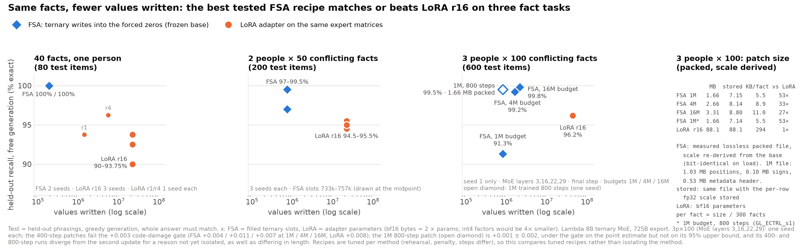
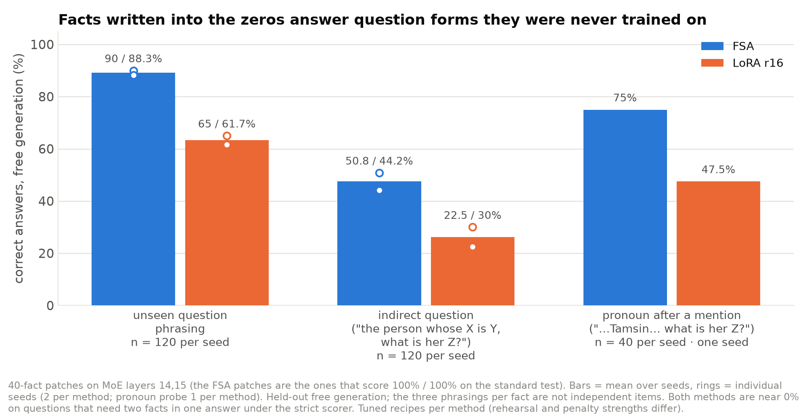
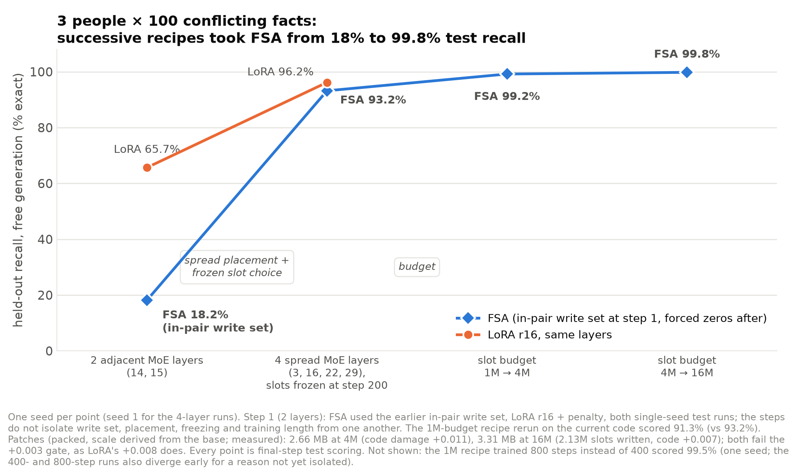
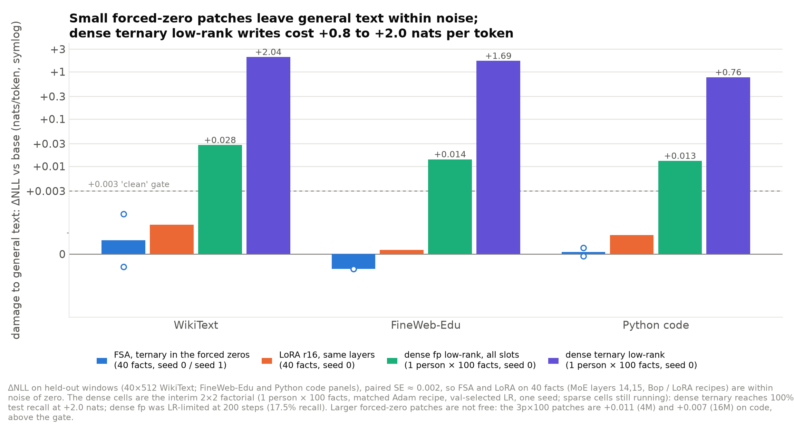
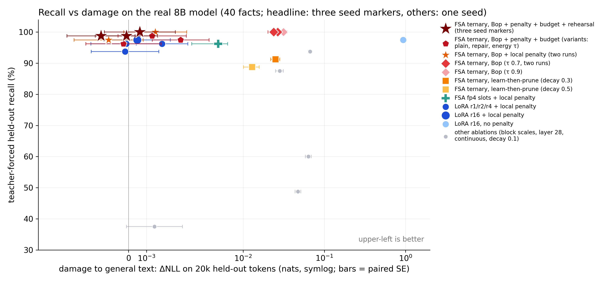
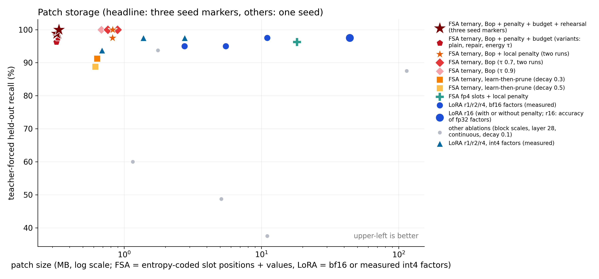
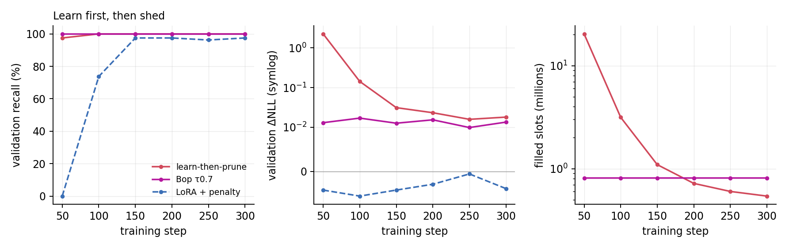
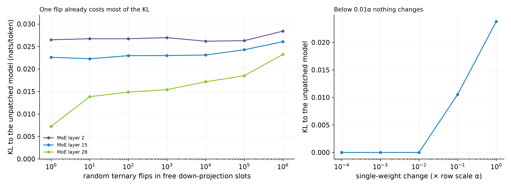

<p align="center">
  
</p>

<h1 align="center">Epigenetic Language Models</h1>

<p align="center"><b>Toward lifelong learning by intercalating knowledge into structural zeros.</b></p>

<p align="center">The base weights never change. New knowledge is written into the zero slots a compressed model already has, with no new parameters, and can be erased bit-exactly when a user asks to be forgotten. The method is <b>Free-Slot Adaptation (FSA)</b>.</p>

<p align="center">
  📄 <a href="paper/freeslot.pdf"><b>Read the paper (PDF)</b></a> <i>(AI-assisted)</i>
  &nbsp;·&nbsp; <a href="#what-we-have-shown-so-far">Charts</a>
  &nbsp;·&nbsp; <a href="#where-it-stands-and-what-comes-next">Where it stands</a>
  &nbsp;·&nbsp; <a href="#how-free-slot-adaptation-works">How it works</a>
  &nbsp;·&nbsp; <a href="#results-forced-zero-mask-2026-10-13">Results</a>
  &nbsp;·&nbsp; <a href="#research-frontier">Research frontier</a>
  &nbsp;·&nbsp; <a href="ARCHITECTURE.md">Architecture</a>
  &nbsp;·&nbsp; <a href="#reproduce">Reproduce</a>
  &nbsp;·&nbsp; <a href="ROADMAP.md">Roadmap</a>
</p>

> [!NOTE]
> **The paper and this write-up were generated with AI assistance**, from experiments run and verified by the authors. Treat the prose as a draft under human review. The results have not been peer-reviewed.
>
> **The paper (`paper/freeslot.tex` / PDF) describes the earlier in-pair variant**, not the forced-zero mask that all current results on this page use. It has not been updated yet; where it disagrees with this page, this page is current.

## The idea

Take a model whose weight format guarantees that at least half of every expert matrix is exactly zero. Freeze every
weight, scale, norm and router. Teach the model something new by writing ternary values only into those guaranteed
zeros. The result is a model that knows what one user taught it, stored in slots the file already had, with no new
parameters and no adapter. Zero the slots and the original model is back, bit for bit. We call the base weights the
genome and the writes an epigenetic layer on top ([why the name](#why-epigenetic)).

This page tells that story from the top down. The charts come first, then the mechanism, then every table, caveat
and dead end for readers who want to go all the way down.

## What we have shown so far

All results are on the lambda 8B ternary mixture-of-experts model (725B-token export). "Test" means held-out
phrasings of the trained questions, scored by free greedy generation: the whole answer must match and the model must
stop cleanly. The comparison is against a LoRA adapter (rank 16 unless noted) on the same expert matrices. Exact numbers,
seeds and run names are in the [results](#results-forced-zero-mask-2026-10-13) and in
[`experiments/epigenesis/LEADERBOARD.md`](experiments/epigenesis/LEADERBOARD.md).

<p align="center">
  
</p>

**Recall per value written.** On three fact tasks of rising difficulty, FSA writes 175k to 2.1M ternary slots and
scores 100% / 100% (40 facts, 2 seeds), 97.0–99.5% (2 people × 50 conflicting facts, 3 seeds) and 99.8% (3 people
× 100 conflicting facts, one seed, 16M-slot budget cap). LoRA r16 writes 22M–44M parameters for 90.0–93.75%,
94.5–95.5% and 96.2%. On the 300-fact task the 16M-cap FSA patch is 3.3 MB as a measured lossless packed file
against 88 MB of bf16 adapter, about 27× smaller. The per-row scale is re-derived from the base and verified
bit-identical on load, so the file does not store it ([what it costs](#what-it-costs)). Smaller LoRA variants
(r1/r4, INT4) have not been run on this task, so that ratio is against r16 bf16 only.
Every final patch fails the code-damage gate (FSA +0.007, LoRA +0.008 ΔNLL). One newer run (open diamond, one
seed) doubled the 1M-budget recipe's training to 800 steps and scored 99.5% with 0.81M slots (1.66 MB packed,
about 53× smaller than the adapter) at +0.001 on code (details below).

<p align="center">
  
</p>

**Generalization.** The same 40-fact patches answer question forms that never appeared in training: unseen phrasings
88–90% against LoRA's 62–65%, indirect questions 44–51% against 22.5–30% (2 seeds each, 120 items), pronoun
questions 75% against 47.5% (1 seed, 40 items). Both methods score near zero when a question needs two facts in one
answer (strict scorer).

<p align="center">
  
</p>

**Closing the gap on 300 colliding facts.** With two adjacent layers FSA fit 18.2% of the test items (earlier
in-pair write set) and LoRA 65.7%. Spreading the write over MoE layers 3, 16, 22 and 29 and freezing the slot choice at
step 200 took FSA to 93.2%; LoRA on the same layers reached 96.2%. Raising the slot budget from 1M to 4M took FSA
to 99.2%, and to 16M 99.8% (599 of 600 items). One seed per point. Doubling the 1M-budget run to 800 steps
gave 99.5% (597 of 600) on one seed; that run is not on this chart because it changes training length rather than
budget, and because run-to-run variance also contributes to it (see [results](#results-forced-zero-mask-2026-10-13)). The spread placement is not clean everywhere: for
the per-person banks, a spread placement that includes layer 3 (layers 3, 16, 22, 29) failed the damage gate
(FineWeb +0.017, code +0.015), while mid-layer banks (layers 12–20) were much cleaner (at most +0.005 on any panel).

<p align="center">
  
</p>

**Damage to general text.** The 40-fact patches move held-out WikiText, FineWeb-Edu and Python code by at most
±0.002 nats per token, within noise of zero, as does LoRA. Writing ternary values densely as a low-rank update
instead of into the forced zeros (1 person × 100 facts, matched Adam recipe, one seed, an interim result) reaches
100% recall and costs +2.04 nats on WikiText. The tested small forced-zero patches left these panels within noise;
the dense ternary low-rank cell did not. Larger forced-zero patches are not free either: the 300-fact patches cost
+0.011 (4M budget) and +0.007 (16M) on code, above the +0.003 gate. The 800-step 1M-budget patch
(light blue, one seed) measures +0.001 ± 0.002 on code: under the gate on the point estimate, but the one-sided 95%
upper bound is above it. Its WikiText gain (−0.028) comes from training with WikiText rehearsal.

Takeaways:

- Knowledge can be stored in slots that are guaranteed zero by the weight format, with the base frozen, and
  revoked exactly. Every patch on this page revokes bit-exactly as a whole patch: zeroing its slots restores the
  exact base. Disjoint slots give mechanical revoke; functional independence requires training against the base forward.
  A bank trained with another bank resident depends on it (−99.5 points, paired 95% CI [−100, −98.5]); mask-only
  training (resident coordinates excluded, resident forward not applied) keeps it independent at 99.5% (capacity
  cost −0.5 points). One seed.
- On the fact tasks measured, FSA matches or beats a LoRA r16 adapter on held-out recall while writing one to two
  orders of magnitude fewer values, and it transfers far better to question forms it was never trained on.
- On the hardest task, successive recipe changes closed the gap: spread placement plus a frozen slot choice
  narrowed a large test loss to 3 points, and larger slot budgets reversed it into a 3.6-point lead over LoRA (one
  seed; the steps do not isolate write set, placement, freezing and training length from one another).
- The remaining cost is damage on larger patches. The 2-layer patches are clean on three panels; the 300-fact
  patches are not, for FSA or LoRA.
- The recipes are tuned recipes rather than a pure method ablation (rehearsal and penalty strengths differ), the
  largest results have one seed, and the serving path for these patches is not built yet.

| task | FSA | LoRA r16 (same layers) |
|---|---|---|
| 40 facts about one person (test) | 100% (2 seeds) | 90.0–93.75% (3 seeds) |
| 2 people × 50 conflicting facts (test) | 97.0–99.5% (3 seeds) | 94.5–95.5% (3 seeds) |
| same 40 facts, asked in unseen phrasings | 88–90% (2 seeds) | 62–65% (2 seeds) |
| same 40 facts, indirect questions | 44–51% (2 seeds) | 22.5–30% (2 seeds) |
| same 40 facts, pronoun questions | 75% (1 seed) | 47.5% (1 seed) |
| 3 people × 100 conflicting facts (test) | 99.8% with a 16M-slot budget cap (3.3 MB packed), 99.2% with 4M (2.66 MB), 91.3% with 1M (1.66 MB) (seed 1, layers 3,16,22,29; code damage +0.007 / +0.011 / +0.004, all fail the 0.003 gate); 800 steps instead of 400 at 1M: 99.5% (1.66 MB packed, code +0.001 ± 0.002, one seed) | 96.2% (seed 1, same layers; 88 MB bf16 / 177 MB saved fp32; code damage +0.008, also fails) |
| new rules (EP-1, multiple choice) | 95.25% / 94.25% dev, 98.2% / 98.2% test (2 seeds) with sleeping-unit gating on 10% of units | 94.75% / 91.25% dev, 98.2% / 96.5% test (2 seeds); dense all-layer fine-tuning 96% dev at +0.20 damage |

The four headline fact and rule claims were checked retroactively by an independent result review against the raw
logs (verdict: confirmed, with caveats). The 300-fact ladder results (4M and 16M) and the 800-step 1M run were
reviewed the same way.

## Where it stands and what comes next

Status as of 2026-10-13.

Working: single-person facts and two-person conflicting facts, written into the forced-zero mask. The tested FSA
recipe beats the tested LoRA r16 recipe on held-out test recall on every seed, and the four re-evaluated patches (two
seeds per task) are clean on all three damage panels. The 40-fact patches generalize to unseen, indirect and pronoun
questions far better than LoRA ([realistic questions](#realistic-questions)).

Working, with LoRA level results: learning rules. Sleeping-unit gating on 10% of units reaches 95.25% / 94.25% dev
and 98.2% / 98.2% test (56/57) at +0.001 / +0.002 damage on two seeds; LoRA reaches 94.75% / 91.25% dev and 98.2% /
96.5% test, so on rules the two methods tie within the resolution of a 57-item test
([EP-1](#ep-1-learning-rules-instead-of-facts)).

Wins on recall, damage open: many conflicting facts. On 3 people × 100 conflicting facts, spread over layers 3, 16,
22 and 29, raising the slot budget from 1M to 4M (1.6M slots actually used, 2.66 MB packed) lifts FSA from 91.3% to
99.2% test recall, and a 16M cap (2.13M slots, 3.3 MB packed) to 99.8%, above LoRA r16's 96.2% (one seed each, same test split,
all scored at their final step). The cost is code-panel damage: +0.011 ΔNLL at 4M and +0.007 at 16M, both failing
the 0.003 gate; LoRA's +0.008 fails it too. Trained for 800 steps instead of 400, the 1M recipe reaches 99.5% (0.81M
slots, 1.66 MB packed) at +0.001 ± 0.002 on code, which passes the gate on the point estimate but not on the
one-sided 95% upper bound. That is one seed, and the 400- and 800-step runs of the same recipe diverge from the
second optimizer update (cause not yet isolated: GPU nondeterminism or a step-count-dependent code path; a same-command replay is queued), so the jump from 91.3% mixes training length with run-to-run
variance. Two more seeds of this run and LoRA r16 at 800 steps (the fair comparison) are queued, and a
preservation-term arm is running.
Dropping WikiText rehearsal made damage worse (FineWeb +0.013, code +0.015), which means rehearsal had been masking
expert damage rather than causing it. Both methods write exactly the same matrices (routed-expert up and down
projections). Validation recall of the original 1M-budget run (the 93.2% patch) peaked at 95.8% at step 300 and fell
to 90.8% by the scored step 400. The no-rehearsal arm fell too (97.5% to 91.7% between steps 300 and 400); the
control rerun rose (91.7% to 93.3%) and the 4M run shows little decline (100% at step 300, 99.2% at 400). The 800-step
1M run did not decline at all (validation 100% from step 400 through 800), so the 400-step drops may be run-to-run
variance rather than instability. Arms aimed at the decline (a slower Bop EMA after the freeze, and a rising
threshold) are still running. Freezing the slot selection early stays the best schedule, and Adam-based writers
remain far behind Bop ([results](#results-forced-zero-mask-2026-10-13)).

Promising: isolated per-person banks, each holding one person's 100 facts, reach 96–100% validation; whether they
work when all are loaded at once is the next measurement ([isolated banks](#isolated-banks)).

Repository patches: measured on our own agent sessions (998 transcripts, 89M tool-result tokens), only 4.9% of
tokens were stable orientation (file discovery and re-reads of files unchanged for a week), while 48% were reads of
files changed within a week. Token savings from a repository patch would be small; its value would have to come from
navigation and override competence.

Open problems, in the order we are working on them:

- Composition: do separately trained banks keep their recall when all are resident in one model, and can the
  model pick the right bank for a question? The composed-recall, router and indexer evaluations are queued behind
  the bank set; nothing is measured yet.
- Rejection: a memory must fire on its own facts and stay silent otherwise. The design gives every selector a
  null choice and tracks "confidently wrong without fallback" as the key safety metric; false activations on
  never-written entities are part of the pending suite.
- The hierarchy: flat selection over many banks will not scale, so the plan is coarse-to-fine: person, then
  attribute group, with a small beam per level and abstention at every node. Twelve attribute-group banks are
  queued for the first two-level versus flat comparison; the first of them has trained (98% validation on its 25
  facts) and the comparison has not run.
- A nursery expert: instead of only writing into forced zeros, add one small new ternary expert per patched
  layer on an additive, hard-gated path (gate off means bit-exact base output), and let it grow or split as facts
  arrive. The design has been reviewed; it has no results yet.
- Cheap writes: an early screen writes 10 facts in 40 steps when the slot support is allowed to turn over
  (100% and 85% test on two seeds); the earlier failure at the same budget came from locking the support early.
  Not yet independently reviewed.
- Serving: the forced-zero patch can give a block more than two active pairs, so it needs a sparse overlay or a
  wider block encoding beside the packed kernel. Neither exists yet, so no serving cost is measured for these
  patches. For the earlier in-pair variant, which keeps the format legal, no slowdown was detected on synthetic
  patches ([serving](#serving-in-pair-variant)).
- Revoke scope: revoke is bit-exact for a whole patch: zeroing the patch's slots restores the exact base.
  Separate slots make revoke mechanical, but a bank stays functionally independent only if it was trained against
  the base forward. In the sequential-revoke test (bank A for one person, then bank B for another, 300 facts world, one seed), B trained with A
  loaded recalled 99.0% of its own facts with A present and 0% after A was revoked (bit-exact revoke). Mask-only
  training (A's coordinates excluded, A's forward not applied) kept 99.5% alone, and B trained on the plain base 100%.
  A bank trained with another bank resident therefore depends on it (−99.5 points, paired 95% CI [−100, −98.5]);
  mask-only training keeps it independent at a capacity cost of −0.5 points, and is now the protocol for every
  sequential write.

Every result before 2026-10-11 used an *in-pair* write set (zeros inside already-selected pairs: 66.8M slots in MoE
layers 14–15, served by the existing packed kernel), which is disjoint from the current forced-zero mask (the two
unselected pairs of every block, about half of every routed-expert weight matrix; patches break pair8 block
occupancy and their serving path is not built). Those results, including the serving benchmarks, are kept in
[earlier results](#earlier-results-in-pair-variant-2026-10-10).

The rest of this page goes one level deeper at a time: the name, the weight format, the method and what it costs,
then every result table, the research frontier, the history, the algorithms, the limitations and how to reproduce.

## Why "epigenetic"

Epigenetic changes alter how a genome is expressed without changing the DNA, and they can be reversed. Here the base
weights play the role of the genome: they are frozen and never edited. What the model learns after deployment lives
in a separate, sparse layer written into slots that were exactly zero, so removing it restores the original model
bit for bit. That is the whole analogy; the rest of this page reports what has been measured and what remains
open.

## What is pair8?

`pair8` is an extreme weight format. Take the weights in aligned blocks of 8 (four adjacent pairs). The rules:

- every weight is ternary — `{ -1, 0, +1 }` times a block scale;
- at most 2 of the 4 pairs in a block may be non-zero.

That second rule forces ≥ 50% of all weights to be exact structural zeros. A block has only 417 reachable states, so
it encodes in ≈ 1.088 information-bits per weight (1.125 bits when packed) — vs 16 bits for bf16. The zeros aren't a
rounding artifact; they're *guaranteed by the format*, which is exactly what makes them a predictable reserve.

```
one pair8 block of 8 weights  (· = forced zero,  ■ = ternary ±1)
┌─────┬─────┬─────┬─────┐
│ ■ ■ │ · · │ ■ ■ │ · · │   ← ≤ 2 of 4 pairs active  ⇒  ≥ 4 of 8 weights are zero
└─────┴─────┴─────┴─────┘
```

## How Free-Slot Adaptation works

<p align="center">
  
</p>

```
Base model:   pair8 ternary MoE. In every 8-weight block at most 2 of 4 pairs are active,
              so at least half of the weights are exact zeros.
Write mask:   the two pairs pair8 did not select: 4 of every 8 weights (at least half).
              This deterministic forced-zero mask ships with the model.

Adapt:        1. Freeze every original weight, scale, norm and router.
              2. Train only slots in the mask (ternary values ±α of the row).
              3. Store filled positions and signs as a removable patch.

Revoke:       zero the mask. The exact pair8 base is restored.
```

The mask rule is fixed: a block’s selected pairs are the ones holding a base nonzero, filled up to two in ascending
pair index if fewer hold one. It is computed once from the released export (sha256 `25a85fd2…`) and never recomputed
from patched weights. Patch values are plain ternary at the row’s scale α.

Filling forced-zero pairs can give a block more than two nonzero pairs, breaking pair8 block occupancy. Serving
therefore needs either a sparse overlay beside the packed kernel or the touched blocks re-encoded in a wider format;
that path is not built, so its overhead is unmeasured. It is potentially low, since patches are sparse, but nothing
below claims or reports a serving cost for forced-zero patches.

Two write sets appear on this page and they should not be confused:

| | in-pair (earlier, until 2026-10-10) | forced-zero (current) |
|---|---|---|
| which zeros | zeros inside the pairs pair8 already selected | the two pairs pair8 did not select in every 8-weight block |
| capacity | 66,807,179 slots in MoE layers 14–15 | exactly half of every routed-expert weight matrix: about 227M slots in MoE layers 14–15 and roughly 3.6 billion model-wide (estimated from the 906 MB bf16 size of the layer 14–15 experts, see [serving](#serving-in-pair-variant), times 32 MoE layers) |
| pair8 legality | kept: the block still has at most two active pairs | broken: a block can end up with three or four active pairs |
| serving | the existing packed kernel; synthetic patches measured with no detectable slowdown | needs a sparse overlay or wider encoding; not built, overhead unmeasured |

### What it costs

Patch storage is measured as a lossless packed file: delta-coded slot coordinates, packed signs and a JSON metadata
header. The per-row scale (α, the mean |nonzero base weight| of each of 1,376,256 rows) is not stored. The loader
re-derives it from the base and checks that it is bit-identical. Every file round-trips bit-identically. Sizes are
the file as shipped, header included, in decimal MB. The 300-fact patches are 1.66 MB (0.81M slots, 1M budget),
2.66 MB (1.6M slots, 4M) and 3.31 MB (2.13M slots, 16M cap) against 88 MB for a bf16 LoRA r16 on the same four
layers. The 1M file breaks down into 1.03 MB of positions, 0.10 MB of signs and a 0.53 MB metadata header.

| 3 people × 100, seed 1 | earlier estimate | packed, scale derived (measured) | packed, scale stored | saved `final.pt` | per fact (derived) | vs LoRA r16 |
|---|---|---|---|---|---|---|
| FSA, 1M budget (GL_CTRL_s1; the 800-step GL_ECTRL_s1 is also 1.66 MB, 7.14 MB stored) | 2.95 MB | 1.66 MB | 7.15 MB | 10.44 MB | 5.5 KB | ≈ 53× |
| FSA, 4M budget (GL_B4M_s1) | 5.80 MB | 2.66 MB | 8.14 MB | 14.38 MB | 8.9 KB | ≈ 33× |
| FSA, 16M budget (GL_B16M_s1) | 7.74 MB | 3.31 MB | 8.80 MB | 17.06 MB | 11.0 KB | ≈ 27× |
| LoRA r16 (R4_lora16_rand4_s1) | 88.1 MB (bf16) | 88.1 MB (bf16) | 88.1 MB (bf16) | 176.7 MB (fp32) | 294 KB | 1× |

Per fact is total size divided by the 300 facts. Storing the scale would add 5.5 MB to every file of these four
layers, whatever its slot count. Smaller patches are cheap the same way: each 100-fact per-person bank is
1.51–1.64 MB packed (about 15–16 KB per fact; 7.0–7.1 MB with the scale stored), and the 40-fact patch on layers
14 and 15 is 0.51 MB (about 12.7 KB per fact; 3.25 MB stored). The header is about 0.5 MB on every four-layer
file and 0.25 MB on the two-layer one, so it is about a third of the smaller patches; compacting it is planned. LoRA r1 and r4, and INT4 adapters, have not
been compared on the 300-fact task. Serving cost for the
forced-zero overlay is pending. For the earlier in-pair variant no slowdown was detected on synthetic patches
([serving](#serving-in-pair-variant)).

### Why this matters

There are three common ways to give a deployed model new knowledge, and each has a cost:

| | put it in the prompt | retrieval (RAG) | fine-tune / LoRA | FSA (this repo) |
|---|---|---|---|---|
| where the knowledge lives | the context window | an external database | new adapter weights | the pair8 forced-zero mask of the existing weights |
| new parameters | none | a separate store | yes | none |
| extra compute per token | grows with the context | retrieval + longer context | an extra matmul (unmerged); none if merged | forced-zero: needs a sparse overlay that is not built, overhead unmeasured; earlier in-pair variant: no slowdown detected on the existing kernel |
| deployed model file | unchanged | unchanged | adapter file, or a merged bf16 copy | base file unchanged plus a small patch (overlay format pending) |
| undo one user's knowledge | drop the text | delete the records | drop the adapter | zero the mask: exact base |

The goal is a personal model that gradually absorbs what one user teaches it, runs on-device, and can be returned to
its original state exactly.

## Results: forced-zero mask (2026-10-13)

Model: the lambda 8B ternary MoE (725B-token export). Writer for the headline rows: Bop with a local output penalty
(λ=10), a netcost slot budget and 0.2 WikiText rehearsal, on MoE layers 14–15 unless noted. The 40-fact and bank runs
started after the damage-panel finding below drop rehearsal; the 300-fact ladder keeps it. Training uses 12 phrasings
per fact with loss on the answer tokens only.
Test items are held-out phrasings. **GEN** (headline) is free-running greedy generation: the whole answer must match
and the model must stop cleanly. **TF** is teacher-forced answer-token recall. Damage is ΔNLL ± paired SE on 40×512
held-out WikiText windows. Every patch revokes bit-exactly. Layer numbers everywhere on this page are MoE layer
ordinals (0–31), the indices the training code takes.

**40 facts about one person (80 test items)**

| method | GEN | TF | damage (WikiText) | slots | seeds |
|---|---|---|---|---|---|
| FSA Bop recipe | 100% / 100% | 100% / 100% | −0.0006 ± 0.0020 / +0.0019 ± 0.0014 | 175k / 188k | 2 |
| FSA, random 25% of the mask | 97.5% | 100% | −0.0000 ± 0.0020 | 252k | 1 |
| FSA, single layer 12 | 98.75% | 98.75% | +0.0014 ± 0.0020 | 225k | 1 |
| LoRA r16 + penalty | 93.75% / 92.5% / 90.0% | 96.25% / 93.75% / 88.75% | +0.0012 to +0.0015 | 22M params | 3 |
| LoRA r4 / r1 | 96.25% / 93.75% | 96.25% / 93.75% | ~0 | 5.5M / 1.4M params | 1 each |

The 2-layer FSA patch (seed 0) re-measured on held-out FineWeb-Edu gives −0.0007 ± 0.0018. A 40-fact patch is
0.51 MB as a measured packed file with the scale re-derived from the base (about 12.7 KB per fact; 3.25 MB with
the scale stored; the earlier estimate was 0.63 MB) ([what it costs](#what-it-costs)).

**2 people × 50 shared attributes with conflicting values (200 test items)**

| method | GEN | TF | damage (WikiText) | slots | seeds |
|---|---|---|---|---|---|
| FSA Bop recipe, 1M budget | 97.0% / 99.5% / 99.5% | 96.5% / 99.5% / 99.5% | −0.0015 / +0.0000 / −0.0026 | 733k–757k | 3 |
| FSA, random 25% of the mask | 97.5% | 98.0% | +0.0010 ± 0.0021 | 761k | 1 |
| LoRA r16 | 94.5% / 95.5% / 95.0% | 96.0% / 94.5% / 95.5% | +0.0010 / +0.0021 / +0.0028 | 22M params | 3 |

On the earlier in-pair write set the same FSA recipe scored 64% on this task. Moving to the forced-zero mask turned a
loss into a win.

**3 people × 100 conflicting facts (validation; test results below the table)**

Every attribute here conflicts across people: 60 attributes are three-way and 60 two-way.

| method | layers | val GEN (step) |
|---|---|---|
| LoRA r16 | 14,15 | 57.5% (1000) / 62.5% (900) |
| FSA Bop, 1M budget, slots re-chosen throughout | 14,15 | 37.5% (500) / 25% (400), then declining |
| LoRA r16 | 3,16,22,29 | 70.8% (200), 95.0% (300), 94.2% (400, 500) |
| FSA Bop, 1M budget, slot selection frozen at step 200 | 3,16,22,29 | 43.3% → 95.0% and 50.8% → 95.8% (step 200 → 300; 2 seeds) |

**Test (held-out phrasings, 600 items), seed 1, MoE layers 3,16,22,29:** FSA Bop (slot selection frozen at step 200)
93.2% GEN, damage WikiText −0.025 (rehearsal-trained), FineWeb −0.005, code +0.009; LoRA r16 96.2% GEN. LoRA wins
that comparison by 3 points on one seed each. With a 4M-slot budget (gap-closing ladder, same seed and split, current
training code) FSA reaches 99.2% test GEN (WikiText −0.036 with rehearsal, FineWeb −0.005, code +0.011), against
91.3% for the 1M control rerun on the same code. With a 16M cap (2.13M slots actually written, 3.3 MB packed) FSA reaches
99.8% test GEN (599/600), WikiText −0.039 with rehearsal, FineWeb −0.002, code +0.007. Code damage falls as the
budget grows from 4M to 16M but still fails the 0.003 gate, as LoRA's +0.008 does. One seed. The LoRA run used an
earlier version of the training code than the ladder.
Every ladder row is a single seed. Two runs of the same recipe and seed that differ only in step count diverge from the
second optimizer update (cause not yet isolated), so single-seed differences of a few points may be run-to-run
variance; a recipe is promoted only after two seeds.

A longer run of the 1M-budget recipe (GL_ECTRL_s1, seed 1, same split, 800 steps with slot selection still frozen
at step 200) reaches 99.5% test GEN (597/600), with WikiText −0.028
(rehearsal-trained), FineWeb −0.007 ± 0.002 and code +0.0010 ± 0.0019. Code passes the 0.003 gate on the point
estimate; the one-sided 95% upper bound does not. It writes 0.81M slots, 1.66 MB packed (about 53× smaller than
LoRA r16 bf16). Validation GEN at steps 100 / 200 / 300 / 400 / 500–800 was 27.5% / 47.5% / 96.7% / 100% / 100%,
with no late decline. Caveats: one seed, and the 400- and 800-step runs of this recipe diverge from the second
optimizer update (cause not yet isolated: GPU nondeterminism or a step-count-dependent code path; a same-command replay is queued) (at step 400 this run was already at 100% validation where the
400-step rerun was at 93.3%), so the jump from 91.3% mixes training length with run-to-run variance. LoRA r16 at
800 steps, the fair comparison, and seeds 0 and 2 are queued. It replaces the 16M row as the headline only if a
second seed reaches at least 99%.

Placement is clearly part of the earlier gap: two adjacent layers are too narrow for 300 colliding facts, for LoRA as
well as FSA. Slot churn is the likely other part: while the budget keeps re-choosing slots it can evict slots holding
learned facts, and recall climbs sharply right after selection is frozen. These runs do not separate freezing from
simply training longer, so churn remains a diagnosis consistent with the jump rather than an isolated cause. The
two-layer rows are earlier checkpoints; later ones reached 27.5% (FSA, step 700) and 60.0–64.2% (LoRA, step 1100).
An earlier two-layer replicate matched its original exactly at step 100; the 300-fact ladder runs with different step counts diverge from the second optimizer update (see the ladder caveat below).

Refreshing slot selection for longer hurts. With 800 steps, freezing selection at step 200 reaches 100% validation
by step 400. Freezing at step 600 collapses to 48% validation at step 500 (val ΔNLL +0.086) but recovers to 100% by step 800
and scores 99.5% test (code +0.003, one seed); never freezing reaches about 50% by step 300. All of these are 3 people × 100, seed 1, validation GEN.

Recall sometimes declined after the freeze in 400-step runs. Between steps 300 and 400 the no-rehearsal arm fell from
97.5% to 91.7% validation, and the original recipe from 95.8% to 90.8%. The 800-step 1M run showed no decline (100%
validation from step 400 through 800), so the earlier drops may be run-to-run variance rather than a property of the
recipe; one run cannot settle that. Two arms aimed at the decline are still running: a slower Bop EMA after the
freeze, and a rising threshold.

Adam-based writers (straight-through ternary, and quinary slots under Adam) stay far behind Bop at the same budget
and steps (best 72.8% test). Whether finer slot values help is therefore still open; it needs a Bop-native quinary
writer, which does not exist yet. A per-row learned scale under Bop (ternary slots plus one learned fp16 scale per
output row; 1M budget, 400 steps, seed 1) reaches 99.5% test GEN but costs +0.007 on code (fails the gate) and
4.45 MB packed (the learned fp16 scale is kept, 2.75 MB), against 1.66 MB for plain ternary.

### Realistic questions

The test set above uses held-out phrasings of the trained question forms. A second set asks the same 40 facts in
ways never seen in training (120 items per probe; 40 for pronouns), scored by free generation:

| probe | FSA, 2 layers (2 seeds) | LoRA r16, same layers (2 seeds) |
|---|---|---|
| unseen question phrasing | 90.0% / 88.3% | 65.0% / 61.7% |
| indirect ("the person whose X is Y, what is her Z?") | 50.8% / 44.2% | 22.5% / 30.0% |
| pronoun after a mention ("…Tamsin… what is her Z?") | 75.0% (seed 0) | 47.5% (seed 0) |

With a single person in the set, the indirect probe does not require resolving "whose X is Y"; it tests answering
through an unfamiliar, indirect question form rather than a true two-hop chain. Knowledge written into the forced
zeros transfers to new question forms far better than a LoRA adapter trained on the same data. Questions that need
two facts in one answer score near zero for both methods under the strict scorer; that scorer requires both values in
the first sentence, and a lenient rescore is pending. The three phrasings per fact are not independent items.

### Isolated banks

Instead of one patch for all 300 facts, each person gets a separate bank trained only on their 100 facts (MoE
layers 12, 14, 17, 20; validation GEN at the final step 300):

| bank layout | person 0 | person 1 | person 2 |
|---|---|---|---|
| each bank may use an unpartitioned 50% sample of the forced mask | 96.7% | 99.2% | 99.2% |
| each bank gets a disjoint third of that sample | 98.3% | 98.3% | 100% |

One seed; validation scores 60 of each bank's 100 facts. Each bank is 1.51–1.64 MB as a packed file (about 15–16 KB per
fact). A sixth of the reserve was enough for each person's 100
facts here. The open question is composition: recall when all banks are resident in one model, and choosing the
right bank for a question. The current disjoint split is block-level, so different people's banks can share hidden
units; a rerun with whole units per bank is queued.

### Placement

Layer matters. On 40 facts with one layer each (test TF): layer 12 98.75%, layer 17 96.3%, layer 20 95%, layer 9
92.5%, layer 25 88.75%, layer 6 86.25%. Middle layers (12–20) are best. Choosing layers by causal tracing was the
worst option on the 300-fact task (7–10% validation), consistent with reports that causal tracing does not predict
where edits work.

Spread placements cost more damage. For per-person banks, a spread placement including layer 3 (layers 3, 16, 22,
29, block-partitioned) failed the damage gate (FineWeb +0.017, code +0.015), while the mid-layer banks (layers 12,
14, 17, 20) were clean to borderline (at most +0.005 on any panel; code +0.004 for the block-partitioned set). The 300-fact ladder results use the spread placement and fail the code gate as
well.

### Damage panels

Early multi-layer patches trained with WikiText rehearsal looked *better* than the base on WikiText (−0.024 to
−0.040). On held-out panels that turned out to be adaptation toward prose rather than preservation:

| multi-layer 40-fact patch | WikiText | FineWeb-Edu | Python code |
|---|---|---|---|
| causal-trace layers (4 layers) | −0.040 | −0.008 ± 0.002 | +0.0076 ± 0.0017 |
| every 4th layer (8 layers) | −0.029 | −0.0076 ± 0.0021 | +0.0065 ± 0.0020 |
| random layers (4 layers) | −0.024 | −0.0056 ± 0.0015 | +0.0001 ± 0.0016 |

The apparent gain follows the rehearsal corpus: rehearsing on FineWeb instead moves the FineWeb panel (−0.0084) and
leaves code at −0.0013, and with no rehearsal the same placement is +0.0018 on FineWeb and +0.0014 on code. The 40-fact and
per-person bank runs since then use no rehearsal; the 300-fact ladder keeps the original recipe's 0.2 rehearsal
(its no-rehearsal arm scored 90.3% with worse FineWeb and code damage). Every run reports all three panels.

The 2-layer winners are clean everywhere:

| patch | test GEN | WikiText | FineWeb-Edu | Python code |
|---|---|---|---|---|
| 40 facts, seed 0 | 100% | −0.0006 ± 0.0020 | −0.0007 ± 0.0018 | +0.0003 ± 0.0017 |
| 40 facts, seed 1 | 100% | +0.0019 ± 0.0014 | −0.0007 ± 0.0016 | −0.0001 ± 0.0015 |
| 2p×50, seed 0 | 97.0% | −0.0015 | −0.0020 ± 0.0019 | −0.0001 ± 0.0018 |
| 2p×50, seed 1 | 99.5% | +0.0000 | −0.0011 ± 0.0020 | −0.0005 ± 0.0016 |

The matched LoRA r16 40-fact patch (seed 0) is at +0.0002 ± 0.0018 on FineWeb and +0.0009 ± 0.0014 on code. Expert
routing on FineWeb barely moves for the FSA patches: about 98–99% top-k overlap with the base.

The dense comparison in the safety chart comes from a 2×2 factorial on 1 person × 100 facts with a matched Adam
recipe and a validation-selected learning rate (one seed): dense ternary low-rank writes reach 100% test GEN at
WikiText +2.04, FineWeb +1.69 and code +0.76, and a second seed shows the same (+1.75 at step 100). Dense
floating-point low-rank writes at the tried learning rates reached only 17.5% test GEN at +0.028 / +0.014 / +0.013,
so that cell is learning-rate-limited at 200 steps and not yet decisive.

### EP-1: learning rules instead of facts

EP-1 asks whether the mask can hold *rules*: support-ticket policies (category plus condition → action) that must be
applied to new tickets. The model cannot apply them even with all rules in its context: 0.30 with the original rules
(0.27 ticket form, 0.34 Q&A form) and 0.27 dev / 0.32 test with coarser rules, against chance 0.25. So it cannot
teach itself. EP-1 therefore trains on ground-truth targets (the pre-registered fallback).

**Sleeping-unit gating** writes only into hidden units of the relu² experts that rarely fire on general text: the 10%
least active. A hinge term pushes those units’ pre-activations negative on general text, encouraging them to stay off
outside the new context. Ternary writes go into the forced-zero mask of those units’ rows.

| arm (400-item dev set, chance ≈ 0.25, base 0.265; rows without a seed count are from the earlier single-seed sweep) | dev accuracy | damage |
|---|---|---|
| sleeping-unit gating, 10% of units, patch scale 1.0α | 95.25% / 94.25% (test 98.2% / 98.2%; 2 seeds) | +0.0011 / +0.0020 |
| sleeping-unit gating, 20% of units | 99.25% (test 100%, 57/57; one seed) | +0.0025 |
| sleeping-unit gating, 5% of units | 95.75% (test 98.2%; one seed) | +0.0025 |
| sleeping-unit gating, 0.5α | 87.5% | +0.0026 |
| gating on the most active 10% instead | 91.5% | +0.014 |
| gating on a random 10% | 95.0% / 93.5% (test 96.5% / 96.5%; 2 seeds) | +0.0036 / +0.0088 |
| gating plus the facts recipe (budget, local penalty, rehearsal) | 32–34% | ~+0.001 |
| no gating, ternary writes at 0.25α | 99.5% | +0.041 |
| dense fine-tuning of all layers (placement study) | 96.25% (step 350) | +0.20 |

Every tested gated 10% learns the rules; choosing the units that are asleep on general text kept damage at noise
level. The facts recipe’s constraints choke rule learning. Dev numbers were used for checkpoint selection, so they
are optimistic. On the 57-item held-out test, sleeping-unit gating scores 98.2% (56/57) on both seeds and a LoRA r16
reference 98.2% / 96.5%, with LoRA at 94.75% / 91.25% on dev at a similar +0.001 damage, so gating matches LoRA
rather than beating it. The 57-item test cannot separate arms above about 96%, and the independent review notes that
sleeping, random and LoRA are within noise of each other, so "sleeping units matter" is not established. The 20%
arm has one seed; its second seed is pending. Gating does not help facts (at most 22% on the 300-fact task).

The first EP-1 attempt (v1, in-pair write set) was not a valid test: its in-context teacher had the answer leaked
into its context, and with a non-leaking context the teacher scored only 0.30
([findings](experiments/epigenesis/EP1_V1_FINDINGS.md)).

## Research frontier

Storage looks much less limiting than before: the frozen-slot global patch holds 300 colliding facts at 99.8% test
with a 16M budget cap, and isolated banks reach 96–100% validation per bank (one seed, 60 facts scored per bank,
composition not yet measured). The open problems are now about access and about damage at scale:

- Composition: do separately trained banks keep their recall when all are resident, and can the model pick the
  right one?
- Indirect access: indirect and multi-fact questions (44–51% and near zero today), true two-hop chains, and
  where the model resolves who a pronoun refers to.
- Cheap writes: the fewest training steps per new bank. For small writes the slot support must stay free to turn
  over (locking it early gave 0–5% on 10 facts); stop each fact once learned.
- Preservation at scale: a preservation term that keeps larger patches under the 0.003 gate on every panel.
- Recurrent state: a fair one-head rotation inside the hybrid costs no perplexity (2 seeds, reviewed); rotation
  everywhere regresses, and phase/resonance addressing is closed (details in the oscillation track's internal
  findings).

Directions:

| direction | idea | source |
|---|---|---|
| isolated banks + routing | one bank per person or topic; select the right bank per question, including all banks resident at once | branching result above |
| hierarchical selection | person, then attribute group; a small beam per level and a null choice at every node | [architecture](ARCHITECTURE.md) |
| nursery expert | a new small gated ternary expert per layer on an additive path; grows or splits by entity cluster | growing-experts design |
| reverse index + cleanup | an index from (relation, value) to entity for "whose X is Y"; snap each hop to a canonical entity before the next read | multi-hop failures |
| late-layer addressing | read a bank's address from the layers where the model has resolved who is being discussed | separability probe |
| binding loss | penalise giving one person’s value for another’s | conflict diagnostics |
| saturation sampling | stop drilling a fact once it is answered cleanly; resample it when forgotten | exposure analysis |
| context-teacher distillation | the base model with the fact sheet in context is the teacher; train the patch to match its full answer distribution | self-study distillation ([Cartridges](https://arxiv.org/abs/2506.06266)) |
| Hebbian write | sum output-direction × whitened input key per fact, keep the mask positions, round to ternary; use as a start for Bop | associative memory; closed-form editors |
| closed-form masked solve | solve for the patch with general-text covariance whitening, then round to ternary with error compensation | [MEMIT](https://arxiv.org/abs/2210.07229), [AlphaEdit](https://arxiv.org/abs/2410.02355) |
| masked Gauss–Newton ternary steps | accept a block of code changes only when the true loss drops | discrete second-order search |
| wake, then write | first train units that fire only on a person-attribute combination, then write the answers from them | sleeping-unit gating result |
| router stability | measure and limit how much a patch changes expert routing downstream | [MoEEdit](https://arxiv.org/abs/2602.10965) |
| learned editor | a small network that maps a fact to a patch in one pass, trained on patches found by the methods above | [MEND](https://arxiv.org/abs/2110.11309), [MALMEN](https://arxiv.org/abs/2311.04661) |

Already adopted from this list: spread placement, slot freezing and a larger slot budget (they closed the 300-fact
gap). GEN is the headline metric because teacher-forced scores can overstate edits. New experiments now require a
design review before launch and a result review against the raw logs before they are reported; the earlier headline
claims were reviewed retroactively. The win condition for the 300-fact task is at least 5 GEN points over LoRA r16
on the same layers, damage ≤ +0.003 on every panel, exact revoke and 2–3 seeds. The 16M result is 3.6 points over
LoRA on one seed, so it meets neither the 5-point bar nor the damage bar yet.

## Earlier results: in-pair variant (2026-10-10)

Everything in this section and the serving section used the in-pair write set: zeros inside pairs pair8 had already
selected (66,807,179 slots at layers 14–15). That set is disjoint from the forced-zero mask. Filling it keeps pair8
legal, which is why its serving cost could be measured. It is kept as history; the forced-zero mask above is the
design. Below, “slots” means in-pair slots.

Teaching 40 facts about “Tamsin Vey” to the lambda 8B ternary MoE, with 12 training formats and two held-out
phrasings (80 items). The headline has three seeds with different fact values and training randomness: seed 1 differs
from seed 0 on 33/40 attribute values, and seed 2 on 34/40. Other runs, including all LoRA baselines, have one seed
each. TF is teacher-forced exact answer-token recall. GEN is free-running greedy recall: the whole answer must match
at a word boundary, with a terminator or end-of-sequence within two tokens after the answer (the model may keep
generating after that). Damage is ΔNLL on 40×512 held-out WikiText windows (± paired SE). Final checkpoints are step
300, except repair, which adds 50 steps with births disabled. All evaluations run one sequence at a time: 16-prompt
batching flipped 15/32 greedy base continuations; 1–2 item recall differences are within noise. The legacy 5×512
KL/top-1 set overlaps training anchors (57% of 32-token sequences); the 40×512 ΔNLL panel, validation and
conversation text have zero overlap, enforced by the evaluation code.

| method | TF | GEN | general-text damage | patch | format |
|---|---|---|---|---|---|
| FSA Bop + penalty + budget + rehearsal (best, seed 0) | 98.75% (79/80) | 98.75% (79/80) | -0.0001 ± 0.0017 | 249,755 slots (0.33–0.84 MB) | packed ternary |
| Same headline recipe, seed 1 | 98.75% (79/80) | 98.75% (79/80) | -0.0015 ± 0.0019 | 245,281 slots (0.32–0.83 MB) | packed ternary |
| Same headline recipe, seed 2 | 100% (80/80) | 100% (80/80) | +0.0006 ± 0.0020 | 255,585 slots (0.33–0.86 MB) | packed ternary |
| FSA Bop + penalty + budget + energy threshold | 98.75% (79/80) | 97.5% (78/80) | +0.0013 ± 0.0019 | 239k slots (0.32–0.81 MB) | packed ternary |
| FSA Bop + penalty + budget + repair | 97.5% (78/80) | 97.5% (78/80) | +0.0029 ± 0.0016 | 251k slots (0.33–0.85 MB) | packed ternary |
| FSA Bop + penalty + budget | 96.25% (77/80) | 95% (76/80) | -0.0003 ± 0.0021 | 244k slots (0.32–0.82 MB) | packed ternary |
| FSA Bop + penalty (rerun) | 97.5% (78/80) | 97.5% (78/80) | -0.0011 ± 0.0019 | 736k slots (0.82–2.48 MB) | packed ternary |
| FSA Bop + penalty (earlier) | 100% (80/80) | — | +0.0015 ± 0.0017 | 740k slots (0.83–2.50 MB) | packed ternary |
| FSA Bop τ0.7 (run 1) | 100% (80/80) | — | +0.0266 ± 0.0035 | 812k slots (0.89–2.74 MB) | packed ternary |
| FSA Bop τ0.7 (repeat) | 100% (80/80) | — | +0.0237 ± 0.0036 | 670k slots (0.76–2.26 MB) | packed ternary |
| FSA Learn-then-prune, decay 0.3 | 91.25% (73/80) | — | +0.0250 ± 0.0032 | 542k slots (0.64–1.83 MB) | packed ternary |
| FSA Learn-then-prune, decay 0.5 | 88.75% (71/80) | — | +0.0129 ± 0.0028 | 523k slots (0.62–1.77 MB) | packed ternary |
| FSA Fp4 + penalty | 96.25% (77/80) | — | +0.0050 ± 0.0015 | 21.27M slots (18.17–79.75 MB) | fp4 slots |
| LoRA r1 + penalty (baseline, fp32 / measured int4) | 93.75% (75/80) / 93.75% (75/80) | 95% (76/80) / 93.75% (75/80) | -0.0002 ± 0.0019 / +0.0021 ± 0.0017 | 1,376,256 params (2.75 MB bf16 / 0.69 MB int4) | adapter |
| LoRA r2 + penalty (baseline, fp32 / measured int4) | 96.25% (77/80) / 97.5% (78/80) | 95% (76/80) / 95% (76/80) | +0.0019 ± 0.0014 / +0.0021 ± 0.0017 | 2,752,512 params (5.51 MB bf16 / 1.38 MB int4) | adapter |
| LoRA r4 + penalty (baseline, fp32 / measured int4) | 96.25% (77/80) / 97.5% (78/80) | 95% (76/80) / 96.25% (77/80) | -0.0001 ± 0.0020 / +0.0003 ± 0.0016 | 5,505,024 params (11.01 MB bf16 / 2.76 MB int4) | adapter |
| LoRA r16 + penalty (baseline) | 97.5% (78/80) | — | +0.0005 ± 0.0018 | 22,020,096 params (44.04 MB bf16) | adapter |

<p align="center">
  
  <br>
  
</p>

Ternary in-pair patches use the same packed kernel; synthetic serving is measured below. Fp4 slots need slot-level
fp4 support. Unmerged LoRA adapters add a matrix multiplication per token.

Patch sizes include positions and values: E entropy-codes positions over 66,807,179 in-pair slots plus one sign bit
per ternary slot; I stores a 26-bit index plus the value. Sizes use decimal MB. The storage figure uses measured bf16
recall for LoRA r1/r2/r4 (95%, 95%, 97.5%); r16: accuracy of fp32 factors, shown at bf16 size because no bf16
evaluation is available. LoRA bf16 uses two bytes per parameter; int8/int4 factor sizes include one bf16 absmax
scale per rank vector. Their recall and damage were measured after fake quantization. Every run revokes bit-exactly:
logits match the base on one 512-token window and test recall returns to 0/80. “—” means generated recall was not
measured.

- Across seeds with different fact values, the headline’s three-seed mean is 99.2% TF and GEN (range 98.75–100%),
  with mean ΔNLL −0.0003 (range −0.0015 to +0.0006) and 245k–256k slots. The figures show three individual seed
  markers; frontier bars are each seed’s paired SE. All three revoke bit-exactly.
- FSA recalls 79–80/80 on all three seeds with different fact values versus LoRA’s 75–78/80 TF and 75–77/80 GEN
  across tested ranks 1–4 and precisions. Gaps of 1–2 items are within noise; 3–4 items may matter, but LoRA’s
  run-to-run spread is unmeasured: ranks 1/2/4/16 still have one seed each. The nearest LoRA size is r1 int4 at 0.69
  MB, 75/80 on both metrics; the alternative FSA encodings bracket that size rather than matching its byte budget
  exactly.
- Damage is within noise of zero for the best penalized FSA runs and fp32 penalized LoRA: |ΔNLL| ≤ 0.003, SE about
  0.002. At this sample size no damage difference is detectable between those methods. The measured r1 bf16/int8
  evaluations are exceptions (+0.0040/+0.0049); all precision results are in the findings. Plain Bop without the
  penalty costs +0.024 to +0.031; the older rows remain as history.
- The earlier 80/80 TF result was not reproduced exactly: its same-configuration rerun gives 78/80 TF and 78/80 GEN
  at −0.0011 ± 0.0019. Variation between executions is a couple of items on the same seed, within noise.
- Where each method stood then: FSA had the best observed recall at a small patch size; the recall gap held across
  three FSA seeds with different fact values, with 1–2 item gaps within noise; single-seed LoRA baselines did not
  establish that FSA beats LoRA overall. Penalized damage was comparable. Synthetic in-pair patches show no
  detectable serving cost; learned patches still need a serving benchmark. These in-pair conclusions are superseded
  by the forced-zero results above, where FSA beats three LoRA seeds.

On the 40-fact in-conversation test, the question follows about 545 tokens of unrelated chat. Generated recall is 85%
for the headline versus 40% for the unbudgeted base (single seed, 40 items); short-prompt recall does not distinguish
them beyond noise.

### Bigger-facts test (in-pair variant)

This run used the in-pair write set; the forced-zero results for this task are in the 3 people × 100 table above.

Three fictional people each have 100 facts, with 30 shared attributes and conflicting values across people for every
fact. Training samples 40 facts per step for 600 steps; testing uses 600 held-out items. Both runs use one seed. LoRA
values below come from the run log’s final evaluation, which follows the earlier checkpoint evaluations. Its result
JSON is not yet written because checkpoint-selection evaluation is still running.

| method | TF | GEN | ΔNLL ± paired SE | slots / parameters |
|---|---|---|---|---:|
| FSA headline recipe, budget raised to 1M | 18.2% | 18.2% | +0.0046 ± 0.0024 | 875,105 slots |
| LoRA r16 + penalty 100, fp32 factors | 63.0% | 65.7% | +0.0017 ± 0.0023 | 22,020,096 params |
| Same LoRA, measured bf16 | 64.3% | 64.3% | +0.0034 ± 0.0018 | same factors |
| Same LoRA, measured int8 | 64.7% | 65.2% | +0.0027 ± 0.0018 | same factors |
| Same LoRA, measured int4 | 64.8% | 66.3% | +0.0029 ± 0.0020 | same factors |

FSA fits only 22.9% of its training facts, gives another person’s value on conflicting attributes 14.2% of the time,
and reaches 8.3% teacher-forced in-conversation recall. The failure to fit the training facts points to a capacity
or optimization limit as well as a generalization gap. Its support never settled: 18.8M births, 12.2M deaths and
5.7M evictions produced an 875k patch. LoRA does much better, and its factors quantize to int4 without loss on this
task. The in-pair budget reruns were superseded by the forced-zero mask.

### EP-1 v1: not a valid test of multi-session consolidation

The FSA arms use the in-pair write set; fp4 and learned scales leave the original pair8 codebook.

In the pre-registered five-session experiment, each session’s self-study was distilled into a patch. On 100 four-way
concept items, the unpatched model scores 0.24 (chance 0.25). Session-5 accuracy is 0.32 for ternary slots with
learned block scales, 0.32 for fp4 slots, 0.32 for ternary Bop, and 0.28 for LoRA. Bop was added after
pre-registration with owner approval.

Every arm failed the thesis: none gained the required 10 concept accuracy points over the unpatched model. Only that
criterion failed. Lure recall (0/50), damage bounds, retention, no lure ratchet and exact revoke all passed; revoke
restored bitwise weights, legal format and identical logits. Session-5 damage is within noise of zero for the ternary
arms; fp4 is +0.0074 ± 0.0020. v1's in-context ceiling (1.00) was invalid: each probe's context held only the correct
policy's source episode, so it already contained the answer. With a non-leaking context (all four rules of the
category) the unpatched model picks the right action only 0.30 of the time (ticket 0.27, Q/A 0.34; chance 0.25). The
identifiability gate was therefore invalid, and the self-distillation teacher was never competent on the probed
skill, so v1 cannot tell whether slots consolidate concepts. EP-1 now uses ground-truth supervised targets on the
forced-zero mask ([EP-1 above](#ep-1-learning-rules-instead-of-facts)). Multi-session consolidation remains open.

## Serving (in-pair variant)

All serving measurements below use synthetic ternary in-pair patches, including the same kernel, file size, memory
and byte-identical packed-file revoke checks. The forced-zero design needs its own overlay kernel, which has not been
built, so its serving cost and memory are pending; its packed file sizes are in [what it costs](#what-it-costs).

Measured on the released lambda GGUF, with the in-pair patch written into the packed pair8 experts
([`experiments/serving/`](experiments/serving/README.md)). Synthetic patches use uniformly drawn slots with random
signs at the size of the earlier Bop patches (670k) and a 3M stress test, over all experts of MoE layers 14–15;
learned patches (now ~250k slots) have not been benchmarked. Speeds are median tokens/s; the patched columns are
patched ÷ base measured in the same round (median [min, max] over rounds).

| device and kernel | base decode | 670k patch | 3M patch | base prefill (512 tok) | 670k / 3M prefill |
|---|---:|---:|---:|---:|---:|
| Mac M5 Max, Metal (`lut9`) | 174.8 | 0.999 [0.96, 1.01] | 0.999 [0.97, 1.03] | 1,075 | 0.999 / 1.001 |
| Mac M5 Max, CPU 8 threads (`lut8`) | 102.2 | 1.005 | 0.990 | 371 | 1.002 / 1.009 |
| Mac M5 Max, CPU 8 threads (`lut`) | 66.0 | 1.006 | 0.998 | 148 | 1.004 / 0.999 |
| Snapdragon 8 Elite phone, Q8 trunk (`lut8`) | 57.0 | 1.002 [0.97, 1.03] | 0.982 [0.95, 1.03] | 209 | 0.996 / 1.000 |

| | base | 670k patch | 3M patch |
|---|---|---|---|
| Mac model file size | 2,133,006,592 B | unchanged | unchanged |
| phone Q8-trunk file size | 1,656,608,512 B | unchanged | unchanged |
| peak memory (Metal / CPU / phone) | 2.75 GiB / 3.29 GiB / 3.24 GB | identical | identical |
| bytes changed in the file | — | 0.99 MB | 4.3 MB |
| revoke | — | byte-identical original (sha256 match) | byte-identical original |

Paired median ratios stay within about 2% of 1.0, with no consistent direction; brackets show min–max over rounds.
On the Metal text-prefill run the ranges touch 1.0 ([0.993, 1.000] and [0.991, 1.000]). No slowdown was detected; a
min–max range is not a significance test and does not prove zero cost. That is expected: each packed block costs one
table lookup whatever it holds, and a patch never turns an all-zero block nonzero. Applying a 670k-slot patch takes
~46 ms in memory (apply A → revoke A → apply B: ~137 ms); today's runtime repacks weights at load, so switching users
means patching the file and reloading (~2 s) until a live hook is added. An unmerged rank-16 LoRA in this runtime is
estimated (not measured; the runtime has no adapter support) at +0.5–1.5% per token plus 44 MB per adapter and new
code in every backend; merging it would turn 64 MB of packed experts into 906 MB of bf16.

## Best algorithms so far

### Writers

1. Bop, latent-free ternary (Helwegen et al. 2019, extended to {−1, 0, +1}). Each writable slot keeps an exponential
   moving average of its gradient; a slot is born (0 → ±1) or dies (±1 → 0) only when that average is consistent and
   exceeds a threshold τ, and the average resets on every change. τ directly sets the flip rate, so a small gradient
   never turns into a full ±α step. Best ternary result so far when combined with the local penalty, budget and
   rehearsal below.
2. Learn-then-prune. fp32 masters + straight-through ternary, AdamW with weight decay on the masters. The model
   learns everything early (~50 steps), then decay pulls weakly supported masters back through the threshold: the
   patch shrank from ~20M to 0.5M slots while recall held.
3. fp4 slots + local output penalty (non-ternary option; in-pair runs only): the penalty is the relative energy of
   the patch's direct output change on general text, Σ‖x·ΔWᵀ‖² / Σ‖x·Wᵀ‖², which avoids KL's routing-chaos floor
   because it measures each patched layer's direct output change.
4. Sleeping-unit gating (rules, forced-zero mask): pick the 10% of relu² hidden units least active on general text,
   write ternary values only into their rows' forced-zero slots, and add a hinge that keeps their pre-activations
   negative on general text. Best rule learner so far (95.25% / 94.25% dev at +0.001 / +0.002 on two seeds; 99.25%
   dev with 20% of units on one seed); it does not help facts.

### Preservation and allocation in the Bop facts recipe

- Local output penalty, λ=10: penalize the relative energy of each patched projection's direct output change on
  general text, using the same penalty described above.
- Slot budget: the allowed slots are re-chosen every 10 steps up to step 200 (the training default; that setting is
  not stored in the result files), by gradient evidence minus expected general-text cost (α² times input-column
  energy), directing births toward useful, less disruptive slots. 300k slots for 40 facts, 1M for 2 people × 50,
  4M and 16M caps for the best 3 people × 100 runs.
- Rehearsal 0.2: optimize 0.8 × fact loss + 0.2 × ordinary next-token loss on WikiText. These windows share no
  32-token sequences with the damage panel, but come from the same corpus. With multi-layer patches this hid real
  damage on code ([damage panels](#damage-panels)), so the 40-fact and bank runs drop rehearsal and every run reports
  FineWeb and code too.
- Energy threshold variant: multiply each row's birth threshold by clamp((e_row / median e)^0.5, 0.25, 4), so rows
  sensitive to general text need more evidence. Repair variant: 50 extra penalty steps with births disabled,
  allowing deaths only. Neither variant establishes an improvement on one seed.

### Ingredients that mattered for every method

- Loss on the answer tokens only. Whole-sentence loss trained models to recite template boilerplate and caused most
  of the early damage.
- Diverse training phrasings including Q/A forms (12 formats, 3 sampled per fact per step). This closed the
  validation→test gap for both FSA and LoRA.
- A broad footprint: all experts of the patched layers, up and down projections. Small footprints starved capacity.
- Damage measured as ΔNLL on a large held-out pool, checkpoints chosen on separate validation text. Any single
  weight change in this model already moves KL-to-base to ~0.02 through routing near-ties, so KL cannot measure
  damage.

<p align="center">
  
  <br>
  
</p>

### What did not work

On the forced-zero mask:

- Straight-through ternary with Adam masters: 2.5–8.5% on the two-person task, and at best 72.8% test on the
  300-fact ladder against 91.3% for the Bop control at the same budget and steps. Quinary slots under Adam: at most
  7% validation.
  A fold-aware variant matched LoRA’s recall at about 10× the damage.
- Projecting a trained LoRA into the mask in one shot (least squares, box-constrained, ternary, GPTQ-style,
  multiscale): at most 19% even before rounding, against LoRA’s 79% on the same task.
- Patch scales below half the row scale: 0.25α gives 31% and 0.125α 4% on 40 facts; 0.5α works (97.5%).
- Sleeping-, specific- or random-unit gating for facts: at most 22% validation on the 300-fact task.
- Causal-trace layer choice: 7–10% validation on the 300-fact task.
- Dense ternary low-rank writes outside the mask: 100% recall at +2.0 nats of damage.

Earlier, on the in-pair write set: KL penalties (they fight the routing-chaos floor and only cost recall); ternary +
smooth penalty + decay (recall peaks, then gets pruned away); tiny-magnitude fp4 (did not learn in our run; its
smallest steps sit near bf16 resolution); patch-only block scales (no better than plain ternary); continuous values
on the slot mask at a single late layer (did not beat LoRA at the same placement).

Churn controls did not improve on the headline. Against the unbudgeted, unrehearsed Bop + penalty base (78/80 TF and
GEN, −0.0011 ± 0.0019, 735,955 slots), keeping newborn slots alive for 20 steps gives 80/80, +0.0024 ± 0.0017 and
543,145 slots; 50 steps gives 79/80, +0.0052 ± 0.0017 and 769,165 slots. Requiring 1.5× the birth threshold for
death gives 79/80, +0.0029 ± 0.0019 and 783,165 slots. Recall differences are only 1–2 items, within noise; damage is
slightly higher, with grace 50 about three SE above zero.

Utility-based flip pruning also failed as a free size reduction. Slots were ranked by a first-order utility estimate
and removed in 10%, then 5%, then 2.5% chunks only if validation recall held. The headline accepted no chunk (0%
removed); removing its “least useful” 10% raised fact loss despite a predicted decrease, and validation TF recall
fell to 81%. The unbudgeted base accepted one 2.5% chunk, keeping 717,557 slots, but test TF fell from 78/80 to 75/80
and GEN from 78/80 to 77/80 (the one-item GEN drop is within noise). The first-order estimate is wrong at a trained
minimum (fact loss ≈ 0.01): gradients are near zero, while reverting a flip is a full-α step. Reverting the predicted
least-useful 10% raised base fact loss by +0.258 versus a predicted −0.025; for the headline, +0.150 versus −0.013.
Just 7.5% of the base patch’s flips carry half the positive first-order utility. The pruning failure diagnoses the
estimate, rather than proving there is no removable slack; exact leave-out by expert and by layer is running.

## Limitations

- Damage. The 2-layer winners are clean on WikiText, FineWeb and code. Multi-layer patches trained with rehearsal
  showed real code damage (up to +0.0076). Without rehearsal they are clean on FineWeb and code, but one placement
  (causal-trace layers) still shows +0.0079 ± 0.0023 on WikiText. The 300-fact patches fail the code gate (FSA
  +0.011 at 4M and +0.007 at 16M, LoRA +0.008).
- Evaluation. Realistic-question probes use 120 items (40 for pronouns) and the pronoun row has one seed per
  method. Two-fact questions score near zero for FSA and LoRA alike with the strict scorer; a lenient rescore is pending.
- Seeds. Facts winners have 2–3 seeds; the 300-fact ladder has one seed; EP-1 gating and its LoRA comparison have
  two seeds at 10% of units and one at 20%, and the 57-item rules test set separates arms by one or two items.
- 300-fact task. The 4M and 16M-budget wins are one seed each; the 1M recipe at 400 steps lost to LoRA on the same
  seed and declined late in training. At 800 steps it reached 99.5% without a decline, on one seed, with run-to-run
  variance mixed into the gain and no 800-step LoRA comparison yet. Isolated banks have not yet been measured with all banks resident.
- Multi-tenant serving. A patch lives inside the weights, so one copy of the weights serves one user's patch at a
  time. LoRA adapters can be batched across many users on one shared base. FSA fits single-tenant and on-device use.
- Revoke scope. Revoke is bit-exact for a whole patch: zeroing the patch's slots restores the exact base. Selective
  unlearning is only safe when later sessions were trained against the base forward: a bank trained while an earlier
  bank was loaded became dependent on it (0% recall alone after the earlier bank was revoked, one seed), while mask-only training (the earlier bank's slots excluded, its forward not
  applied) kept 99.5% (capacity cost −0.5 points).
- Format. Forced-zero patches can exceed pair8’s two-pair limit, so they need a sparse overlay or a wider block
  encoding; serving cost and memory are not measured yet. Packed file sizes are measured, with the per-row scale
  re-derived from the base and verified bit-identical on load; about 0.5 MB of each file is a JSON metadata header.
- Privacy. Knowledge in weights can be elicited from the model; a per-user model is the safe deployment.

## Reproduce

The current results use `--method fsa_forced` (the forced-zero mask). Commands below are the logged command lines;
they need one 32 GB GPU, the lambda 8B export and the mesh-lambda code (see the harness header), and run from a box
holding the export and the `data/` anchor and evaluation panels.

```bash
# 3 people × 100 conflicting facts, 4M slot budget (99.2% test, GL_B4M_s1).
# Use --budget 16000000 for the 16M run (99.8%) and --budget 1000000 for the 1M control (91.3%).
python experiments/end_to_end/e2e_fsa.py --method fsa_forced --optim bop --bop-gamma 0.05 --bop-tau 0.7 \
    --local-lambda 10 --support-score netcost --cost-rel 1 --rehearsal-frac 0.2 --no-churn --budget 4000000 \
    --people 3 --facts-per-person 100 --shared-attrs 30 --fact-batch 40 --val-facts 60 --conv-test --conv-facts 60 \
    --steps 400 --eval-every 100 --micro 6 --no-pareto --sparse-state --expert-checkpoint --layers 3,16,22,29 \
    --slot-frac 0.5 --anchor data/anchor-wikitext.json --anchor-bs 2 --anchor-len 96 --answer-only \
    --eval-set data/eval-wikitext.json --aug --extra-eval-sets data/eval-fineweb.json,data/eval-code.json \
    --train-audit 120 --strata --fast-moe exact --base-cache base_cache --seed 1
python figures/make_story_figs.py                                # rebuild the charts at the top of this page
```

No exact training command line was logged for the 40-fact runs (F40_bopck_s0/s1), so none is given here. Their
recipe flags (Bop τ 0.7, λ=10, 300k netcost budget, rehearsal 0.2, layers 14,15) appear in the load-evaluation
command in [`experiments/end_to_end/C56_REPORT.md`](experiments/end_to_end/C56_REPORT.md) (section PG_eval_fla2).

Earlier in-pair variant (2026-10-10 results only; `fsa_free` writes zeros inside already-selected pairs, not the
forced-zero mask):

```bash
python experiments/end_to_end/e2e_fsa.py --method fsa_free --optim bop --bop-tau 0.7 --bop-gamma 0.05 \
    --layers 14,15 --answer-only --aug --anchor <anchor.json> --eval-set <eval.json> --steps 300 --out bop.json
python experiments/end_to_end/e2e_fsa.py --method lora --rank 16 --lr 3e-4 --layers 14,15 --local-lambda 100 \
    --answer-only --aug --anchor <anchor.json> --eval-set <eval.json> --steps 300 --out lora.json
python figures/make_e2e_figs.py experiments/end_to_end/data      # rebuild the in-pair figures from the saved runs
```

Every run, including the ones that did not work, is described in
[`experiments/end_to_end/E2E_FINDINGS.md`](experiments/end_to_end/E2E_FINDINGS.md); the forced-zero runs are logged
in [`experiments/epigenesis/LEADERBOARD.md`](experiments/epigenesis/LEADERBOARD.md).

## Prior art

[PackNet](https://arxiv.org/abs/1711.05769) · [Latent weights do not exist (Bop)](https://arxiv.org/abs/1906.02107) ·
[LoRA](https://arxiv.org/abs/2106.09685) · [LoRA Learns Less and Forgets Less](https://arxiv.org/abs/2405.09673) ·
[Cartridges](https://arxiv.org/abs/2506.06266) · [ROME](https://arxiv.org/abs/2202.05262) ·
[MEMIT](https://arxiv.org/abs/2210.07229) · [AlphaEdit](https://arxiv.org/abs/2410.02355) ·
[MEND](https://arxiv.org/abs/2110.11309) · [MALMEN](https://arxiv.org/abs/2311.04661) ·
[MoEEdit](https://arxiv.org/abs/2602.10965) · [Does localization inform editing?](https://arxiv.org/abs/2301.04213) ·
BitNet b1.58 (ternary). FSA is specific to *format-reserved* sparse capacity: the free slots exist because of the
quantization format.

## How claims were checked

Every claim here went through repeated rounds of adversarial review, and the write-up was revised until the findings
stopped changing. Headline numbers were re-read from the raw run logs by a reviewer who did not write the code.

## License & attribution

Code: Apache-2.0. Paper & figures: CC-BY-4.0. By [Chutes.ai](https://chutes.ai) / Parallax. Paper and write-up
AI-assisted (see the note at the top).
